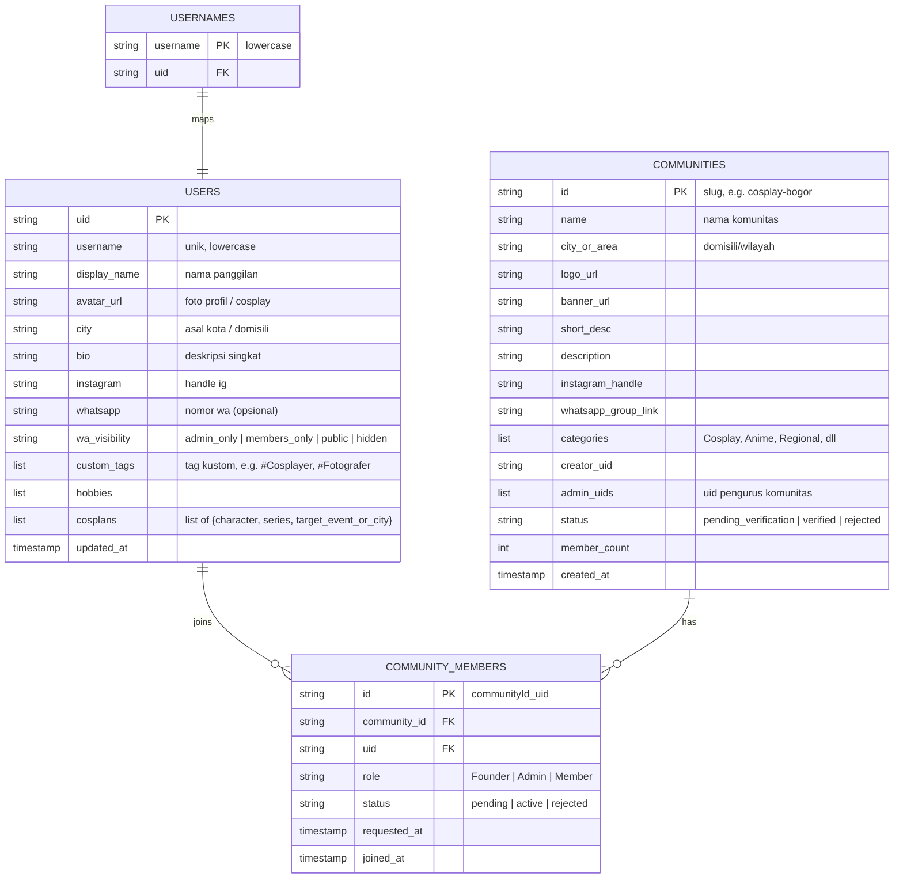
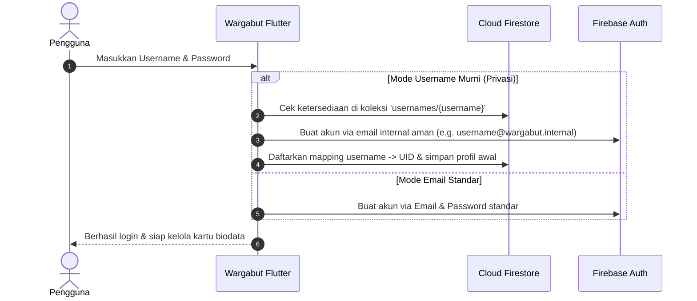
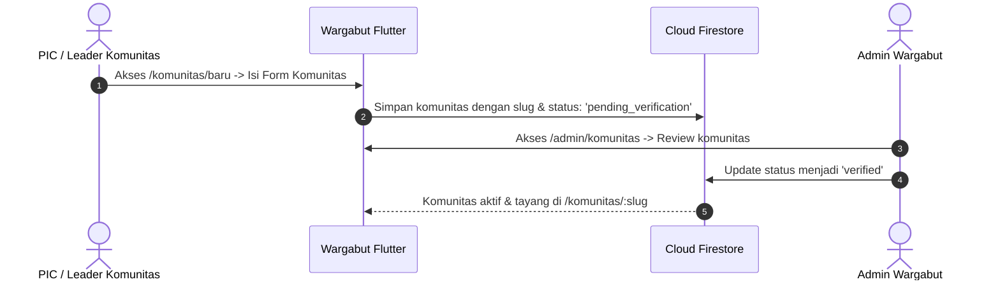
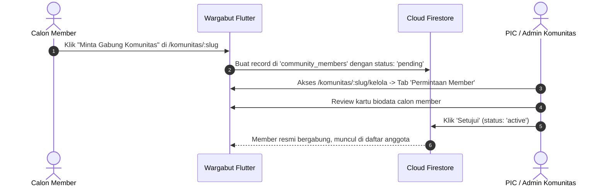

# Rencana Implementasi: Direktori Komunitas & Biodata Member ("WargaKomunitas")

Dokumen ini telah diperbarui dengan rancangan **Skema URL & Slug Pendek** (seperti `wargabut.id/komunitas/:slug` dan `wargabut.id/@username`), sistem privasi nomor WhatsApp, approval bertingkat, serta autentikasi username fleksibel.

---

## 🌐 Skema URL & Slug Pendek (Clean Routing)

Aplikasi Flutter Web Wargabut sudah menggunakan `usePathUrlStrategy()`, sehingga mendukung URL bersih tanpa tanda `#`. Skema routing dirancang seringkas dan seintuitif mungkin:

| Fungsi | Pola URL | Contoh Nyata | Keterangan |
| :--- | :--- | :--- | :--- |
| **Direktori Komunitas** | `/komunitas` | `wargabut.id/komunitas` | Publik, daftar semua komunitas |
| **Daftar Komunitas Baru**| `/komunitas/baru` | `wargabut.id/komunitas/baru` | Form registrasi komunitas baru |
| **Profil Komunitas** | `/komunitas/:slug` | `wargabut.id/komunitas/cosplay-bogor` | Profil, info, & daftar anggota |
| **Kelola Komunitas** | `/komunitas/:slug/kelola` | `wargabut.id/komunitas/cosplay-bogor/kelola` | Khusus PIC: approval member |
| **Kartu Biodata Member** | `/@:username` (atau `/:username`) | `wargabut.id/@sandi` | Kartu digital member (siap share) |
| **Edit Biodata Diri** | `/@me` | `wargabut.id/@me` | Pintasan kelola biodata sendiri |
| **Verifikasi Admin** | `/admin/komunitas` | `wargabut.id/admin/komunitas` | Khusus Admin Wargabut |

> [!TIP]
> **Format `/@:username` (ala Twitter/TikTok)**
> Penggunaan prefix `@` sangat direkomendasikan karena:
> 1. Langsung mengindikasikan profil personal/kreator saat dibagikan di media sosial.
> 2. Menghindari bentrok teknis (*route collision*) dengan rute sistem aplikasi.
> 3. Jika pengguna mengakses `/:username` tanpa `@`, sistem dapat otomatis melakukan *redirect* ke `/@:username`.

> [!IMPORTANT]
> **Aturan Reserved Usernames**
> Untuk mencegah konflik URL, kata-kata berikut dilarang digunakan sebagai username saat registrasi:
> `admin`, `komunitas`, `login`, `welcome`, `jeventku`, `anichekku`, `dkonser`, `wguide`, `api`, `profile`, `setting`, `wargabut`.

---

## Ringkasan Keputusan Desain

1. **Penamaan Modul**: 
   - Modul dinamakan **WargaKomunitas** dengan base URL ringkas: `/komunitas`.
2. **Privasi Nomor WhatsApp**:
   - Disediakan **opsi pengaturan privasi** langsung saat mengisi nomor WhatsApp:
     - `Hanya untuk Pengurus/Admin Komunitas`
     - `Hanya Sesama Anggota Komunitas Terdaftar`
     - `Publik (Semua Pengguna Wargabut)`
     - `Sembunyikan Total / Privat`
3. **Alur Bergabung ke Komunitas**:
   - Anggota yang ingin bergabung **wajib melalui persetujuan (approval) Admin/PIC Komunitas**. Status awal adalah `pending`, dan admin komunitas memiliki tab `/kelola` untuk menyetujui (*Approve*) atau menolak (*Reject*).
4. **Verifikasi Pendaftaran Komunitas Baru**:
   - Komunitas baru yang didaftarkan berstatus `pending_verification` dan **wajib diverifikasi oleh Admin Wargabut** sebelum tampil di daftar publik.
5. **Metode Login Fleksibel (Termasuk Username + Password)**:
   - Untuk menjaga privasi pengguna yang tidak ingin membagikan email pribadinya, sistem mendukung login berbasis **Username + Password** di samping opsi login Email & Password standar.
6. **Badge & Custom Tags Anggota**:
   - Anggota dapat menambahkan **Custom Tags** bebas sesuai persona mereka (contoh: `#Cosplayer`, `#KamenRiderFans`, `#Fotografer`, `#AnisongLover`, `#WibuNolep`).
7. **Cosplan & Integrasi Masa Depan ("Project Cosplay")**:
   - Field cosplan pada kartu biodata dibuat terstruktur (Karakter, Judul Anime/Game, Target Wilayah/Event) sehingga *future-ready* untuk fitur mendatang: **Project Cosplay** (mencari partner cosplay dari anime yang sama di event/wilayah tertentu).
8. **Tautan Resmi Komunitas**:
   - Menampilkan **Akun Instagram Komunitas** dan **Link Bergabung ke Grup WhatsApp** (`chat.whatsapp.com/...`).

---

## Arsitektur Data Firestore

---

## Alur Kerja Sistem (Workflows)

### 1. Alur Registrasi & Login (Username + Password)

### 2. Alur Pendaftaran Komunitas (Verifikasi Admin Wargabut)

### 3. Alur Bergabung Komunitas (Approval PIC Komunitas)

---

## Rincian Perubahan File & Komponen

### 1. Konfigurasi & Routing
- **[MODIFY] [app_menus.dart](file:///c:/Users/sandy/Documents/github/wargabut/lib/app/config/app_menus.dart)**:
  - Menambahkan menu `WargaKomunitas` dengan route `/komunitas`.
- **[MODIFY] [main.dart](file:///c:/Users/sandy/Documents/github/wargabut/lib/main.dart)**:
  - Mendaftarkan rute GoRouter:
    - `/komunitas`: Halaman direktori komunitas.
    - `/komunitas/baru`: Form buat komunitas baru.
    - `/komunitas/:slug`: Halaman detail komunitas.
    - `/komunitas/:slug/kelola`: Halaman approval anggota untuk PIC.
    - `/@:username`: Tampilan publik kartu biodata member.
    - `/@me`: Halaman edit biodata diri sendiri.
    - `/admin/komunitas`: Panel verifikasi komunitas admin.

### 2. Data Models & State Management
- **[NEW] [community_model.dart](file:///c:/Users/sandy/Documents/github/wargabut/lib/app/models/community_model.dart)**:
  - Model data komunitas (nama, slug, kota, medsos, status verifikasi).
- **[NEW] [user_profile_model.dart](file:///c:/Users/sandy/Documents/github/wargabut/lib/app/models/user_profile_model.dart)**:
  - Model biodata member: username, nama panggilan, kota, hobi, custom tags, cosplan, sosmed, WA dan level privasinya.
- **[NEW] [community_provider.dart](file:///c:/Users/sandy/Documents/github/wargabut/lib/app/provider/community_provider.dart)**:
  - State management daftar komunitas, pencarian, pendaftaran komunitas, dan persetujuan member.
- **[NEW] [profile_provider.dart](file:///c:/Users/sandy/Documents/github/wargabut/lib/app/provider/profile_provider.dart)**:
  - State management biodata profil, check username ketersediaan, update cosplan/tags.

### 3. Tampilan Antarmuka (UI Components & Screens)
- **[NEW] [community_list_page.dart](file:///c:/Users/sandy/Documents/github/wargabut/lib/app/ui/screens/community/community_list_page.dart)**:
  - Halaman eksplorasi komunitas (search, filter kota/kategori, card komunitas).
- **[NEW] [community_detail_page.dart](file:///c:/Users/sandy/Documents/github/wargabut/lib/app/ui/screens/community/community_detail_page.dart)**:
  - Banner, logo, info IG & tautan grup WA, daftar anggota komunitas.
- **[NEW] [community_manage_page.dart](file:///c:/Users/sandy/Documents/github/wargabut/lib/app/ui/screens/community/community_manage_page.dart)**:
  - Tab kelola permintaan bergabung (approve/reject).
- **[NEW] [create_community_page.dart](file:///c:/Users/sandy/Documents/github/wargabut/lib/app/ui/screens/community/create_community_page.dart)**:
  - Form registrasi komunitas baru (otomatis membuat slug ramah URL).
- **[NEW] [edit_profile_biodata_page.dart](file:///c:/Users/sandy/Documents/github/wargabut/lib/app/ui/screens/profile/edit_profile_biodata_page.dart)**:
  - Form kelola biodata diri (username, nickname, kota, tag kustom, cosplan, no WA + privasi setting).
- **[NEW] [member_profile_page.dart](file:///c:/Users/sandy/Documents/github/wargabut/lib/app/ui/screens/profile/member_profile_page.dart)**:
  - Halaman kartu digital biodata member (tampilan modern dengan tombol *"Salin Format Intro"* untuk WhatsApp/Discord).
- **[NEW] [admin_community_verification_page.dart](file:///c:/Users/sandy/Documents/github/wargabut/lib/app/ui/screens/admin/admin_community_verification_page.dart)**:
  - Halaman admin untuk me-review dan memverifikasi komunitas baru.

---

## Rencana Verifikasi & Pengujian (Verification Plan)

### 1. Pengujian Rute & Slug Pendek
- [ ] Akses `wargabut.id/komunitas`: direktori komunitas terbuka tanpa error.
- [ ] Akses `wargabut.id/komunitas/cosplay-bogor`: detail komunitas terbuka langsung dari slug.
- [ ] Akses `wargabut.id/@sandi`: kartu profil terbuka menampilkan biodata publik user `sandi`.
- [ ] Akses `wargabut.id/@me`: otomatis membuka halaman edit biodata user yang sedang login.

### 2. Pengujian Autentikasi & Privasi
- [ ] Registrasi akun baru dengan username dan password (tanpa email).
- [ ] Pengisian no WA dengan privasi *Hanya Sesama Member*: verifikasi bahwa pengunjung luar tidak bisa melihat no WA tersebut.

### 3. Pengujian Alur Komunitas & Approval
- [ ] Pendaftaran komunitas baru -> status `pending_verification` -> disetujui oleh admin Wargabut -> tayang di `/komunitas`.
- [ ] Member minta gabung -> status `pending` -> disetujui PIC di `/komunitas/:slug/kelola` -> resmi aktif.
