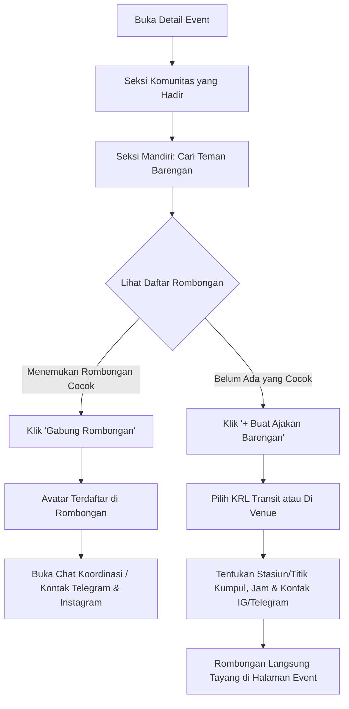

# Rencana Implementasi: Fitur "Cari Barengan" ke Event (Transit KRL & Teman di Venue)

Dokumen ini merancang solusi terstruktur untuk masalah sosial pengunjung event wibu/pop-culture yang **ingin ke event tapi merasa ragu atau takut karena sendirian** (*solo event-goer*).

---

## Analisis Masalah & Desain Pendekatan

### Pertanyaan Desain: *Fitur Diskusi Bebas vs. Fitur Cari Barengan Terstruktur?*

| Aspek | Opsi A: Diskusi / Komentar Bebas di Tiap Event | Opsi B: Fitur Cari Barengan Terstruktur (LFG) | Opsi C (Dipilih): **Sistem Hibrida (Kartu Rombongan Terstruktur + Diskusi Mikro)** |
| :--- | :--- | :--- | :--- |
| **Pencarian Teman KRL / Transit** | **Sulit**: Komentar tenggelam bercampur dengan pertanyaan tiket, jadwal, atau review event. | **Sangat Efektif**: Terfilter rapi berdasarkan stasiun asal KRL, jalur kereta, atau moda transportasi. | **Sangat Efektif**: Terstruktur dengan jelas (Stasiun KRL asal, jam kumpul, dan titik temu). |
| **Hambatan Sosial (Awkwardness)** | **Tinggi**: Orang pemalu ragu menulis *"ada yang dari Bogor gak?"* di forum terbuka tanpa kepastian respon. | **Rendah**: Cukup klik *"Gabung Rombongan"* pada slot yang tersedia (misal 2/4 orang). | **Sangat Rendah**: Pengguna merasa bergabung ke sebuah rencana nyata, bukan sekadar chat dingin. |
| **Kepastian Jadwal & Titik Kumpul** | **Rendah**: Janjian sering buyar karena tidak ada titik kumpul dan jam pasti yang tercatat. | **Tinggi**: Ada field jelas: *Titik Kumpul (Peron/Stasiun)*, *Jam Berangkat*, dan *Hari Event*. | **Tinggi**: Jelas terpampang di kartu rombongan. |
| **Komunikasi Lanjutan & Privasi** | Terbuka di halaman event (rentan spam/doxxing). | Hanya tombol status tanpa tempat tanya jawab singkat. | **Optimal & Aman**: Diskusi mikro di kartu rombongan, serta kontak **Telegram / Instagram** langsung terhubung ke profil sosial. |

> [!TIP]
> **Kategori Barengan**:
> 1. 🚆 **Berangkat Bareng (Transit / KRL / Transportasi Umum)**: Berfokus pada titik kumpul stasiun KRL/MRT (misal: *Stasiun Manggarai*, *Stasiun Bogor*, *Stasiun Tanah Abang*, *Stasiun Cisauk*, dll.) dan jam keberangkatan.
> 2. 🎪 **Barengan di Venue (On-Site Buddy)**: Berfokus pada aktivitas di dalam event (misal: *Teman Muter Artist Alley*, *Hunting Foto Bareng*, *Teman Cosplay / Helper*, *Nemenin Jajan / Makan Siang*).

---

## Keputusan Desain Berdasarkan Masukan Pengguna

> [!IMPORTANT]
> 1. **Saluran Kontak (Telegram & Instagram)**:
>    - Sesuai masukan, kontak rombongan menggunakan **Telegram** (username/link `t.me/...`) dan/atau **Instagram** (handle `@username`). Ini jauh lebih aman dan nyaman bagi komunitas anime/pop-culture daripada membagikan nomor telepon pribadi.
> 2. **Penempatan Seksi di Halaman Event (Berdiri Sendiri)**:
>    - Seksi **"Cari Barengan"** diletakkan sebagai **seksi mandiri (terpisah di luar info rute transit)** di halaman detail event (`event_detail.dart`), sehingga langsung terlihat jelas oleh setiap pengunjung event tanpa harus membuka opsi transit terlebih dahulu.
> 3. **Kapasitas Rombongan**:
>    - Pembuat rombongan dapat menentukan kapasitas (misal: 2–6 orang, atau Bebas/Tanpa Batas). Jika kuota terpenuhi, kartu otomatis berlabel `Penuh`.
> 4. **Diskusi Mikro per Rombongan**:
>    - Setiap kartu rombongan memiliki ruang tanya jawab / koordinasi singkat khusus untuk rombongan tersebut.

---

## Proposed Changes

### 1. Data Model & Firestore Schema

#### [NEW] [event_companion_model.dart](file:///c:/Users/sandy/Documents/github/wargabut/lib/app/models/event_companion_model.dart)
Model data untuk menyimpan rombongan di koleksi Firestore `event_companions`:
- `id`: ID dokumen Firestore
- `eventId`: ID event JEventku terkait
- `eventName`: Nama event
- `creatorUid`: UID pembuat rombongan
- `creatorName`: Nama pembuat
- `creatorUsername`: Username pembuat
- `creatorAvatar`: Foto profil pembuat
- `title`: Judul ajakan (contoh: *"KRL bareng dari Stasiun Bogor jam 07:30"*, *"Cari teman muter Comifuro Day 1"*)
- `type`: `'transit'` (Berangkat bareng) atau `'venue'` (Di lokasi event)
- `transitLine`: Jalur transit (opsional, misal: *KRL Lintas Bogor*, *KRL Lintas Cikarang*, *KRL Lintas Rangkasbitung*, *MRT*, dll)
- `meetingPoint`: Titik kumpul (misal: *Stasiun Manggarai Pintu Barat*, *Lobi Hall 10 ICE BSD*)
- `meetingTime`: Hari & estimasi waktu kumpul (misal: *Sabtu, 08:00 WIB*)
- `activityTag`: Tag aktivitas (misal: *Hunting Merch*, *Cosplay Buddy*, *Santai / Ngobrol*, *First Timer Friendly*)
- `notes`: Deskripsi/catatan tambahan
- `maxMembers`: Batas kuota (misal: 4 orang, atau 0 untuk tanpa batas)
- `members`: List anggota yang bergabung `[{'uid': ..., 'username': ..., 'name': ..., 'avatar': ..., 'joinedAt': ...}]`
- `telegramHandle`: Username Telegram pembuat / link grup (opsional)
- `instagramHandle`: Handle Instagram pembuat (opsional)
- `status`: `'open'` (Terbuka), `'full'` (Penuh), `'completed'` (Selesai)
- `createdAt`: Waktu dibuat

#### [NEW] [companion_message_model.dart](file:///c:/Users/sandy/Documents/github/wargabut/lib/app/models/companion_message_model.dart)
Model untuk pesan/diskusi koordinasi di dalam rombongan (disimpan di subkoleksi `event_companions/{companionId}/messages`):
- `id`, `senderUid`, `senderName`, `senderAvatar`, `senderUsername`, `message`, `createdAt`

---

### 2. State Management & Provider

#### [NEW] [companion_provider.dart](file:///c:/Users/sandy/Documents/github/wargabut/lib/app/provider/companion_provider.dart)
Mengelola rombongan event secara real-time via Stream / Firestore:
- `getCompanionsStream(String eventId)`: Mendengarkan daftar rombongan aktif untuk event terkait.
- `createCompanion(...)`: Menerbitkan ajakan rombongan baru.
- `joinCompanion(String companionId, Map<String, dynamic> memberData)`: Bergabung ke rombongan.
- `leaveCompanion(String companionId, String uid)`: Keluar dari rombongan.
- `deleteCompanion(String companionId)`: Menghapus rombongan (khusus pembuat / admin).
- `getMessagesStream(String companionId)`: Stream pesan tanya jawab rombongan.
- `sendMessage(String companionId, String message, Map<String, dynamic> senderData)`: Mengirim pesan koordinasi.

---

### 3. Komponen Antarmuka Pengguna (UI)

#### [NEW] [event_companion_section.dart](file:///c:/Users/sandy/Documents/github/wargabut/lib/app/ui/components/companion/event_companion_section.dart)
Seksi mandiri yang berdiri sendiri di halaman detail event:
- **Header Seksi**:
  - Icon `groups_rounded` + Judul *"Cari Teman Barengan"* + Badge penghitung rombongan aktif.
  - Subtitle *"Temukan rombongan naik KRL/transit bareng atau teman jalan bareng di venue event."*
  - Tombol aksi: `+ Buat Ajakan Barengan` (membuka dialog pembuatan).
- **Filter Tab**:
  - `Semua` | `🚆 Berangkat Bareng (KRL/Transit)` | `🎪 Di Lokasi Event`
- **Kartu Rombongan (Companion Card)**:
  - Header kartu: Avatar pembuat (klik untuk buka Member Card), nama & username, badge tipe (`Transit KRL` / `Di Venue`), dan badge kuota (`2/4 Anggota` atau `Penuh`).
  - Info Utama: Judul ajakan, titik kumpul berikon pin, jam kumpul berikon jam, dan label aktivitas.
  - Avatar bar: Menampilkan avatar anggota yang sudah bergabung.
  - Kontak Cepat: Tombol **Telegram** dan **Instagram** (klik langsung membuka aplikasi Telegram / Instagram web).
  - Tombol Aksi:
    - `Gabung Rombongan` (jika kuota masih ada).
    - `✓ Anda Bergabung` / `Keluar` (jika sudah bergabung).
    - `Diskusi & Koordinasi` (membuka modal / drawer pesan singkat rombongan).

#### [NEW] [create_companion_dialog.dart](file:///c:/Users/sandy/Documents/github/wargabut/lib/app/ui/components/companion/create_companion_dialog.dart)
Modal dialog pembuatan ajakan barengan:
1. Pilihan Tipe:
   - 🚆 **Berangkat Bareng (Transit / KRL)**:
     - Preset dropdown stasiun KRL populer (Bogor, Manggarai, Tanah Abang, Juanda, Bekasi, Cikarang, Serpong, Jurang Mangu, Cisauk, Sudirman) atau input stasiun/halte bebas.
     - Hari & Jam Kumpul.
   - 🎪 **Barengan di Lokasi Event**:
     - Titik kumpul di venue (misal: Gate Masuk, Mushola, Area Booth).
     - Tag aktivitas (Hunting Merchandise, Hunting Foto Cosplay, Teman Makan, First Timer Friendly).
2. Kuota Maksimal (Pilihan: 2 orang, 3 orang, 4 orang, 5 orang, atau Bebas/Tanpa Batas).
3. Catatan Rombongan (misal: *"Saya baru pertama kali ke sini, santai aja jalan bareng"*).
4. Kontak Komunikasi:
   - Input username **Telegram** (contoh: `@wibubogor` atau link grup Telegram).
   - Input username **Instagram** (contoh: `@wibuberbudaya`).

#### [NEW] [companion_chat_dialog.dart](file:///c:/Users/sandy/Documents/github/wargabut/lib/app/ui/components/companion/companion_chat_dialog.dart)
Modal / BottomSheet ringan untuk koordinasi & tanya jawab anggota rombongan:
- Daftar pesan real-time dari anggota.
- Input bar untuk mengirim pesan koordinasi (misal: *"Saya sudah di peron 2 ya kak"*).

#### [MODIFY] [event_detail.dart](file:///c:/Users/sandy/Documents/github/wargabut/lib/app/ui/screens/detail/event_detail.dart)
- Menyematkan `EventCompanionSection` sebagai seksi utama tersendiri di halaman detail event (ditempatkan di antara seksi komunitas yang hadir dan info rute transit).

---

## Alur Interaksi Pengguna (User Flow)

---

## Verification Plan

### Automated Verification
- Menjalankan `flutter analyze` pada seluruh model, provider, dan widget baru untuk memastikan **0 errors**.

### Manual Verification
1. **Skenario Buat Rombongan KRL**:
   - Buka event detail (misal: Midori Festival / Comifuro).
   - Klik `+ Buat Ajakan Barengan` -> pilih tipe *Berangkat Bareng*, pilih *Stasiun Manggarai*, jam *08:00 WIB*, masukkan handle Telegram `@user_tg` dan Instagram `@user_ig`.
   - Simpan -> kartu rombongan langsung muncul di seksi Cari Barengan.
2. **Skenario Bergabung & Koordinasi**:
   - Akun lain membuka event -> klik `Gabung Rombongan`.
   - Kuota terupdate (misal 1/4 -> 2/4).
   - Buka `Diskusi & Koordinasi` -> kirim pesan koordinasi singkat -> pesan muncul real-time.
   - Klik tombol Telegram / Instagram -> membuka aplikasi terkait dengan benar.
